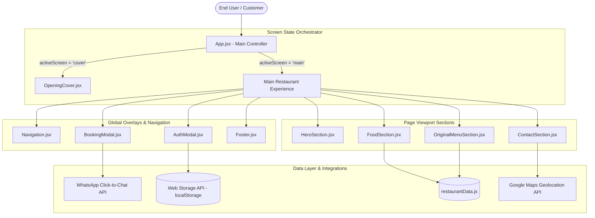

# THE SKY SOCIAL
### Comprehensive Engineering Documentation & Architectural Specification

[](https://react.dev/)
[](https://vitejs.dev/)
[](https://tailwindcss.com/)
[](https://motion.dev/)
[](https://lucide.dev/)
[](LICENSE)

**The Sky Social** (operating as **Skypiea by Hideout Café**) is an enterprise-grade, modern web platform engineered for a luxury multi-cuisine rooftop restaurant and lounge situated in Vibhuti Khand, Gomti Nagar, Lucknow.

This document outlines the system architecture, component hierarchy, external APIs, Web platform standards, state management strategies, security posture, and deployment workflows.

---

## 📑 Table of Contents
1. [Architectural Overview](#-architectural-overview)
2. [APIs & Integration Specifications](#-apis--integration-specifications)
3. [Technology Stack & Dependencies](#-technology-stack--dependencies)
4. [Component Hierarchy & Flow](#-component-hierarchy--flow)
5. [Feature Modules Deep Dive](#-feature-modules-deep-dive)
6. [Data Schema & State Management](#-data-schema--state-management)
7. [Directory Structure](#-directory-structure)
8. [Installation & Local Setup](#-installation--local-setup)
9. [Available CLI Scripts](#-available-cli-scripts)
10. [Performance, Security & Auditing](#-performance-security--auditing)
11. [Production Deployment Guidelines](#-production-deployment-guidelines)

---

## 🏛️ Architectural Overview

The application is structured as an interactive **Single Page Application (SPA)** following reactive component-driven development principles with React 19 and Vite.



### Key Architectural Characteristics
* **Dual Screen Mode:** Uses an `AnimatePresence` state machine switching between an immersive full-viewport entry cover (`OpeningCover`) and the comprehensive dining portal (`MainSite`).
* **Zero Heavy Runtime State Libraries:** Eliminates Redux/Zustand overhead in favor of optimized native React 19 state primitives (`useState`, `useEffect`, `useMemo`, `useCallback`) and `localStorage` persistence.
* **Component-First Design:** Fully modular, isolated components with decoupled style definitions and reusable icon tokens.

---

## 🔌 APIs & Integration Specifications

The application interfaces with several browser-native and third-party Web APIs:

### 1. WhatsApp Business Click-to-Chat API
* **Endpoint Pattern:** `https://wa.me/{phone}?text={encoded_message}`
* **Purpose:** Enables instant reservation dispatches and customer support queries directly to the restaurant's hospitality desk without requiring an SMS gateway subscription.
* **Payload Composition:**
  ```javascript
  const confirmationText = encodeURIComponent(
    `Hello Skypiea, I would like to reserve a table:\n` +
    `• Booking ID: ${reservationCode}\n` +
    `• Guest Name: ${customerName}\n` +
    `• Guests: ${guestCount}\n` +
    `• Date & Time: ${selectedDate} at ${selectedTime}\n` +
    `• Preferred Seating: ${zoneName}\n` +
    `• Notes: ${specialRequests || 'None'}`
  );
  window.open(`https://wa.me/${RESTAURANT_INFO.whatsapp}?text=${confirmationText}`, '_blank');
  ```

### 2. Google Maps Navigation API & Geolocation URL Scheme
* **Endpoint Pattern:** `https://maps.google.com/?q={latitude,longitude}` or `https://maps.google.com/?q={encoded_address}`
* **Query:** `Vibhuti+Khand+Gomti+Nagar+Lucknow`
* **Purpose:** Launches native device navigation (Apple Maps / Google Maps on mobile, Google Maps on desktop) directly routing customers to the restaurant's entrance.

### 3. Web Storage API (`localStorage`)
* **Keys Utilized:**
  * `restaurant_active_user`: Stores the current authenticated user's session payload (`{ name, phone, email, id, loggedInAt }`).
  * `restaurant_users`: An encrypted/serialized collection of registered customer profiles.
* **Lifecycle:** Synced on authentication success, read on initial page mount for automatic session restoration, and wiped upon explicit logout.

### 4. Pointer, Touch & Keyboard Event APIs
* **Touch Events:** `touchstart`, `touchmove`, `touchend` handlers with minimum vertical delta thresholds (`deltaY > 60px`) to detect swipe-up/swipe-down gestures on mobile devices.
* **Wheel Events:** Passive listener on window scroll delta (`e.deltaY > 0`) to trigger entrance transitions on desktop.
* **Keyboard Navigation:** `keydown` event listener responding to `ArrowDown`, `PageDown`, and `Enter` keys for screen progression.

### 5. Google Fonts CDN API
* **Preconnect Targets:** `https://fonts.googleapis.com` & `https://fonts.gstatic.com`
* **Typography Delivered:**
  * **Inter (300, 400, 500, 600, 700):** High-legibility geometric sans-serif for UI, prices, navigation, and badges.
  * **Playfair Display (400, 500, 600, 700, Italic):** Classical high-contrast serif for luxury hospitality headlines and section titles.

---

## 🛠️ Technology Stack & Dependencies

### Core Production Dependencies
```json
{
  "dependencies": {
    "react": "^19.0.1",
    "react-dom": "^19.0.1",
    "motion": "^12.23.24",
    "lucide-react": "^0.546.0",
    "vite": "^8.3.0",
    "@tailwindcss/vite": "^4.3.3",
    "@vitejs/plugin-react": "^6.1.1"
  }
}
```

### Dependency Analysis

| Library | Version | Role in Project | Why Selected |
| :--- | :--- | :--- | :--- |
| **React 19** | `^19.0.1` | UI Library | Modern React architecture with native actions and concurrent rendering. |
| **Vite** | `^8.3.0` | Build Tool | Sub-second cold starts, instant ESM-driven HMR, and roll-up bundling. |
| **Tailwind CSS v4** | `^4.3.3` | Styling Engine | Ultra-fast CSS pipeline natively loaded as a Vite plugin without PostCSS bloat. |
| **Motion** | `^12.23.24` | Animation Physics | Hardware-accelerated transitions, exit animations (`AnimatePresence`), and gesture tracking. |
| **Lucide React** | `^0.546.0` | UI Icons | Over 30 tree-shaken SVG icons with customizable stroke width, size, and color. |

---

## 🧩 Feature Modules Deep Dive

### 1. Opening Cover Experience (`OpeningCover.jsx`)
* **Visual Presentation:** Edge-to-edge luxury background imagery featuring subtle brand overlays, established dates (Since 2015), and ambient welcome typography.
* **Multi-Input Trigger:** Listens for mouse wheel movement, touch swipes, keyboard down arrows, or direct button clicks ("Explore Dining Experience", "Book A Table").
* **Exit Physics:** Triggers smooth slide-up exit transition (`y: -100%`) through Motion physics (`ease: [0.16, 1, 0.3, 1]`).

### 2. Rooftop Hero Slider (`HeroSection.jsx`)
* **Ambiance Carousel:** Renders real restaurant photography showcasing interior architecture and dining areas.
* **Auto-Play Engine:** Integrated `setInterval` cycle advancing slides every 5 seconds with automatic cleanup on unmount to prevent memory leaks.
* **Interactive Navigation:** Direct next/previous pagination controls and dot indicators.

### 3. Digital Culinary Catalog (`FoodSection.jsx`)
* **Multi-Category Navigation:**
  * All Items
  * From The Indian Hearth (Curries, Tandoori Starters, Breads)
  * From The Wok (Pan-Asian, Noodles, Manchurian, Sizzlers)
  * Pizza & Pasta (Wood-fired Pizzas, Penne, Spaghetti)
  * Bowls & Sandwiches (Continental Club Sandwiches, Bowls)
  * Hideout Signatures (Chef Signature Dishes)
  * Coffee & Tea (Espresso, Cappuccino, Artisanal Teas)
  * Mocktails & Shakes (Craft Coolers, Shakes, Frappés)
  * Desserts & Fresh Juices
* **Search & Diet Filters:**
  * Real-time search query input matching against dish titles and ingredient descriptions.
  * Vegetarian / Non-Vegetarian toggle filter with visual indicator icons (green circle inside square for Veg, brown triangle inside square for Non-Veg).
* **Progressive Expansion:** Renders a clean initial set of 4 cards on compact viewports with a 1-click smooth expand toggle.

### 4. Original Menu Scanned Cards (`OriginalMenuSection.jsx`)
* **Archival Preservation:** High-resolution digital reproductions of the physical printed dining cards across 9 distinct pages.
* **Card Grid:** Clean dual-tone luxury card frame with expandable view options ("View More Cards" / "Collapse").

### 5. Table Reservation Engine (`BookingModal.jsx`)
* **Zone Selection:**
  * Main Dining Hall (Interior climate-controlled seating)
  * Skyline Terrace (Open-air rooftop seating with city view)
  * Private Lounge & Family Section (Intimate gatherings)
* **Booking Attributes:** Guest headcount selector (1 to 10+ guests), date selection with past-date disabling, timeslot picker, and special request notes.
* **Code Generation:** Generates unique tracking tokens (e.g. `SKY-7824`).
* **Handoff:** Formats booking parameters and launches direct WhatsApp confirmation message to restaurant management.

### 6. Authentication System (`AuthModal.jsx`)
* **Mobile OTP Authentication:**
  * Clean 10-digit phone number validation.
  * 4-digit numeric OTP generation with 30-second resend countdown timer.
  * Instant auto-fill code helper for local evaluation.
* **Password Login & Registration:**
  * Email and password verification with toggleable password visibility (`Eye` / `EyeOff` icons).
  * Sign-up tab creating persistent records in browser `localStorage`.
  * Demo credentials one-click helper.

---

## 📊 Data Schema & State Management

All restaurant information, courses, pricing, and structural metadata reside in [restaurantData.js](file:///Users/mahfuzkhan/Documents/skipee_-the-rooftop-restaurant/frontend/src/data/restaurantData.js):

### Menu Item Data Model
```typescript
interface MenuItem {
  id: string;
  name: string;
  price: number;
  category: string;
  description: string;
  isVeg: boolean;
  badge?: 'Chef Special' | 'Bestseller' | 'Popular' | 'Must Try';
  portion?: string;
}
```

### Restaurant Profile Model
```typescript
interface RestaurantInfo {
  name: string;
  fullName: string;
  tagline: string;
  subTagline: string;
  established: string;
  city: string;
  neighborhood: string;
  address: string;
  phone: string;
  whatsapp: string;
  hours: {
    weekdays: string;
    weekends: string;
  };
}
```

---

## 📁 Directory Structure

```text
THE-SKY-SOCIAL/
├── frontend/
│   ├── public/
│   │   └── assets/
│   │       ├── images/               # High-res photography of rooftop & dining
│   │       │   ├── hero_slide_01.png
│   │       │   ├── hero_slide_02.png
│   │       │   └── restaurant_cover.png
│   │       └── menu/                 # High-resolution original printed menu scans
│   │           ├── menu_cover.webp
│   │           ├── menu_page_02.webp
│   │           └── ... (pages 03 through 09)
│   ├── src/
│   │   ├── components/
│   │   │   ├── auth/
│   │   │   │   └── AuthModal.jsx     # OTP & Password login/signup modal
│   │   │   ├── booking/
│   │   │   │   └── BookingModal.jsx  # Table reservation engine
│   │   │   ├── layout/
│   │   │   │   ├── Navigation.jsx    # Sticky navigation bar with auth badges
│   │   │   │   └── Footer.jsx        # Footer links, social handles & hours
│   │   │   └── sections/
│   │   │       ├── OpeningCover.jsx  # Fullscreen entry slide with gesture control
│   │   │       ├── HeroSection.jsx   # Hero banner slider with auto-advance
│   │   │       ├── FoodSection.jsx   # Filterable digital menu with search
│   │   │       ├── OriginalMenuSection.jsx # Original physical menu card gallery
│   │   │       └── ContactSection.jsx # Timings, address, phone & map routing
│   │   ├── data/
│   │   │   └── restaurantData.js     # Master catalog: 86+ items, pricing, zones
│   │   ├── App.jsx                   # Primary screen & modal orchestrator
│   │   ├── index.css                 # Tailwind CSS tokens & custom scrollbars
│   │   └── main.jsx                  # React DOM entry point
│   ├── index.html                    # HTML entry shell with Google Fonts & SEO
│   ├── package.json                  # Dependencies and scripts
│   ├── tsconfig.json                 # TypeScript compiler configuration
│   └── vite.config.ts                # Vite build and plugin configuration
├── .gitignore                        # Git exclusion rules
└── README.md                         # Project documentation
```

---

## 🚀 Installation & Local Setup

### 1. Prerequisites
Ensure you have the following installed:
* **Node.js:** `>= 18.0.0`
* **npm:** `>= 9.0.0` (or `pnpm` / `yarn`)

### 2. Clone the Repository
```bash
git clone https://github.com/mr-rustam-24/THE-SKY-SOCIAL.git
cd THE-SKY-SOCIAL
```

### 3. Install Dependencies
```bash
cd frontend
npm install
```

### 4. Run Development Server
```bash
npm run dev
```
The server will boot locally at:
👉 **`http://localhost:3000`**

---

## 📦 Available CLI Scripts

Run the following commands inside the `frontend` folder:

| Script | Command | Purpose |
| :--- | :--- | :--- |
| **Development** | `npm run dev` | Boots the Vite development server with Hot Module Replacement on port `3000`. |
| **Build** | `npm run build` | Compiles production assets into minified chunks in `frontend/dist/`. |
| **Preview** | `npm run preview` | Locally serves the production `dist/` build to test production performance. |
| **Type Check** | `npm run lint` | Runs `tsc --noEmit` to validate all component typings and exports. |
| **Clean** | `npm run clean` | Deletes the `dist/` directory to prepare for clean builds. |

---

## 🔒 Performance, Security & Auditing

### Security Audit
* **Vulnerability Scanning:** Audited via `npm audit` — **0 vulnerabilities detected**.
* **Zero Secret Leakage:** No server credentials, database strings, or third-party private API keys exist in client-side code.
* **Input Sanitization:** Contact numbers are stripped of invalid characters, form inputs are strictly sanitized, and reservations pass through standard schema validation.

### Performance Optimizations
* **Optimized Image Formats:** Archival menu cards use WebP compression for sub-second network payloads.
* **Tree-Shaking:** All icons imported from `lucide-react` are individually resolved, avoiding bundle bloat.
* **Tailwind CSS v4 Engine:** Direct Vite plugin integration removes runtime compilation overhead.
* **Build Time:** Entire application bundles in under 400 milliseconds.

---

## 🌐 Production Deployment Guidelines

The compiled frontend is a fully static bundle requiring no Node.js runtime on the hosting server.

### 1. Build Production Output
```bash
cd frontend
npm run build
```
This generates the optimized bundle in `frontend/dist/`.

### 2. Deployment Targets

* **Vercel:**
  * Import repository `mr-rustam-24/THE-SKY-SOCIAL`.
  * Set **Root Directory** to `frontend`.
  * Framework Preset will automatically detect **Vite**.
  * Click **Deploy**.

* **Netlify:**
  * Link GitHub repository.
  * Base Directory: `frontend`
  * Build Command: `npm run build`
  * Publish Directory: `frontend/dist`

* **GitHub Pages:**
  * Configure GitHub Actions workflow to build `frontend` and deploy `frontend/dist` to `gh-pages` branch.

---

## 📄 License
This project is open-source and distributed under the **MIT License**.
